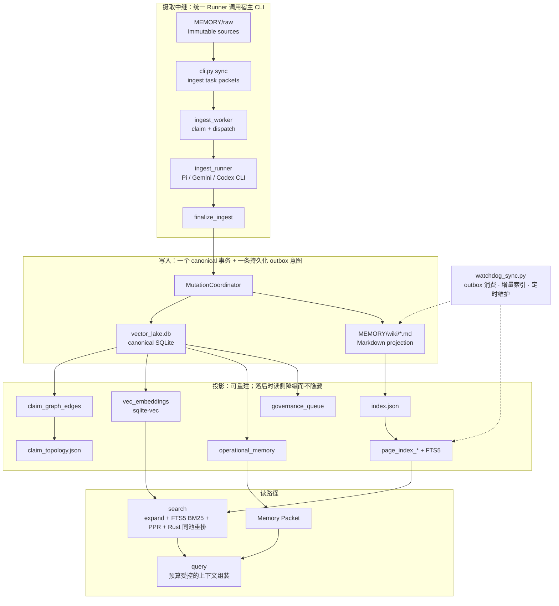

# 架构、数据契约与模块地图

所有命令和源码路径均相对于仓库根目录；先使用 README 核对过的项目虚拟环境。本文是参考，不是可整段执行的安装脚本。

[返回项目首页](../README.md)

## 数据路径与边界

- `MEMORY/raw`：原始信源层，只读输入。
- `MEMORY/wiki`：人类可读的 Markdown 发布层，用于审阅、浏览和复盘。
- `MEMORY/wiki/index.json` 与 `MEMORY/wiki/claim_topology.json`：从 canonical 写出的页面节点/加权边及断言拓扑投影。检索实际读取 SQLite 的 `page_index_*` 与 FTS5 投影；投影落后时回退读 `index.json`，并标记 `[DEGRADED]`。
- `MEMORY/wiki/.meta/vector_lake.db`：保存实体、断言、证据、信源、图拓扑、变更集与治理队列，并从 canonical claims 编译 `fact / preference / decision / task_state` 到 `operational_memory`。
- `MEMORY/purpose.md`：版本化目的与证据控制面。YAML 契约驱动 `core / edge / other` 分类、证据使用、意图权重、SIR 复审和张力合成阈值；摄取资格仍由目录、格式、隐私与授权决定。合格来源保留 canonical Source，未核实主张仍归属于来源。`purpose_vectors.json` 仅是旧版回退，不再是权重主源。

如果 `MEMORY/wiki/.meta` 不可写，运行时可能回退到仓库 `data/v8_meta/`。部署和诊断应核对实际元数据路径，不能把回退目录误认为预期数据库或健康证明。

## Architecture



核心原则：**Markdown 是人类界面，`.meta` 是事实底座，`operational_memory` 是 Agent 运行层**；投影可重建，而唯一的写入顺序是「canonical 事务 → outbox → 投影」。

### 摄取中继的执行、恢复与完成边界

图中的箭头不是一次同步调用。`sync` 写入 SQLite `jobs`，Worker 持有 120 秒派发租约，生成任务包并转入 `awaiting_subagent`；Runner 再持有默认 3600 秒模型租约。`awaiting_subagent` 是共享队列状态，Gemini/Codex 使用它也不代表实际创建了子代理。`sync` 返回入队成功不等于编译完成；常驻 Runner 会继续消费，因此也不能把入队当作无后续写入的预览。

Runner 只在执行槽位空闲时认领任务：串行逐项认领，并发最多认领空闲槽位数。`--limit` 是本轮最多处理的任务数，不再提前占用整个批次的租约。默认单任务模型预算 900 秒（配置上限 3300 秒），初始执行和修复共享 deadline，且为租约结束前保留 120 秒余量。Windows Job Object / POSIX 进程组负责拥有的子进程生命周期，不等于文件或网络隔离。

模型返回的 `files_written` 是文件名和内容组成的草案，不是已经落盘的文件。宿主保留来源、候选清单和租约字段；`finalize_ingest` 校验版本、权限范围、页面契约后才提交。失败与租约释放同样需要当前 claim：旧 token/generation、过期租约或终态作业均不得回写。内部失败记录/释放调用传入 `claim=claimed_task`；未提供 claim 的旧式管理调用仅可处理未认领的 `queued` / 预算内 `failed`，不能推断当前所有者的令牌。

修复和重试共用 `ingest_errors` 分类：候选 canonical/投影版本过期不让模型修补旧令牌，重新派发且不消耗来源失败预算；缺字段、命名或 Schema 错误允许有界修复。默认每个作业 3 次失败预算，每次最多 1 次初始执行加 2 轮修复，即确定性校验持续失败时最多 9 次适配器调用。版本冲突不消耗预算，此数不是所有故障的全局调用上限，也不是 Pi 父会话和子代理的底层模型请求数。

摄取合同 v10 仅允许模型返回 `standalone` 或 `integrated`，两者均须实际提交 canonical Source 页。范围外材料用 `strategic_scope: other`；无法归级时省略 `evidence_tier` 并说明限制。没有专属类别时使用 `General_Knowledge`。空正文和零入选简报也保留 Source，不编造知识。Runner 的 `finalized` 表示出版或已有当前 Source 的去重关闭；新作业的 `content-rejected`、`missing-source-closed` 保留为兼容计数字段但不再增长。原文消失属于错误，不能关闭为成功。`duplicate` / `missing-source` 旧字段仍是检测次数，不保证关闭成功；执行失败看 `errors` 与 `model-failed`。这些都是当前 Runner 进程的计数，不是数据库历史总量。Health 的 `runner.outcomes` 对旧快照缺失字段返回 `null`，不把未知补成零。`projection_outbox_pending` / `projection_outbox_failed` 单独展示全库 outbox 工作，不是某个作业的投影完成回执；outbox 清空也不证明向量全部更新。

### 模型后端的权限与留存边界

统一的是任务 JSON 和 `finalize_ingest` 提交协议，不是执行权限或模型服务。三个内置后端均没有默认失败切换；切换已运行的后端需要先停止/排空原消费者，修改配置不证明运行态已经切换。

|后端|执行与来源输入|工具及文件边界|本地适配器留存|
|-|-|-|-|
|Pi|无界面父 Pi 会话要求委派给项目 `vector-lake-ingestor`；子代理读取明确指定的原始来源|默认摄取子代理仅有 `read`，fresh context，不继承全局/项目上下文；父会话仍使用宿主 Pi 策略，适配器未给整个执行链增加 OS 沙箱。显式 agent override 需单独核验，不能套用默认子代理保证|会话保存在 `scratch/runner_sessions`（不可写时使用临时目录）；失败时保存完整 stdout/stderr。按年龄/数量清理不是立即删除，也不是凭证脱敏|
|Gemini|宿主读取来源、核对内容指纹，将正文及授权候选送入 stdin|请求 deny-all 工具策略，禁用 MCP、扩展、hooks 和项目上下文；适配器未增加 OS 沙箱|适配器临时文件自动清理，不主动保存模型输出；CLI 自身与提供方留存另行遵循其策略|
|Codex|同上|请求禁用工具/功能、MCP、插件和项目文档；CLI 使用 `read-only` sandbox 与 `--ephemeral`|结果 Schema/最后消息临时文件自动清理；提供方留存不由适配器控制|
|自定义 `--model-cmd`|宿主通过 shell 执行，并检查返回 JSON|命令本身的权限、工具、额外写入与联网没有被内置适配器验证；仅适用于明确受信的宿主命令|由自定义命令决定|

`--check` 不认领任务、不验证认证，也不发送真实模型请求。输出的 `capability_scope` 区分 Pi 的可执行文件解析、Gemini 的 headless 参数检查、Codex 的参数/功能门检查和自定义命令的未检查状态；`execution_boundary` / `local_retention` 描述静态边界，`boundary_verified=false` 表示不能将这些描述或 help 探针当作运行态安全验收。`authentication_verified=false` 不代表认证失败，而是本次没有验证。

本地 CLI 不等于本地推理：正文和候选上下文仍可能发送到宿主 CLI 配置的模型提供方。CLI/提供方留存、日志外发和来源传输需要遵守数据授权；Pi 完整失败日志可能含来源内容或其他敏感信息，不可直接作为可公开分享的诊断包。后端边界核验不通过时应停止，不得通过换 CLI 绕过认证、生命周期或授权限制。

### 后端暂停、续批、耗时与探针缓存

`claim_ingest_tasks` 返回每一个实际认领的作业；不可读/损坏的包以错误任务返回，不在认领时预先扣失败预算。缺失任务包路径仍返回 `null`，保持原数组协议；Runner 消费错误任务时才按当前租约记录一次失败。因此坏任务不会隐藏健康任务，也不会让本轮实际认领数超过 `--limit`。

来源/页面校验失败仍使用原有来源预算。模型进程退出、超时、无效交付 JSON 和宿主运行故障则保留来源预算，通过带围栏的释放等待重试；它们不是内容拒绝。Runner 将后端状态写入 `.meta/runtime/runner_backend_state.json`：前两次连续执行故障分别退避 5、10 秒，第三次进入 `open`，不再认领或发起新模型调用，重启也不自动清零。已经运行的并发调用可以结束，迟到成功不能自动解除 `open`。在途请求可能多于三次，三次是暂停触发阈值，不是并发时的总请求数上限。

状态损坏/不可读时停止启动，不伪造健康。修复后可由所有者显式使用 Runner 的 `--reset-backend` 清除暂停；此操作必须取得同一根的消费者锁，不能与 `--check` 合用，不验证认证，也不能重置已有来源失败次数。该标志随后会按正常 Runner 模式执行工作，故实际运行/服务重启须另有授权；磁盘代码修改不会自动激活服务或清除暂停状态。Health 单独报告 `runner_backend_paused`，默认告警/strict 降级规则保持不变。

`--interval` 现在是最大空闲等待：有可执行积压时让步 1 秒后续批；空队列按 5、10、20、40、80 秒退避到配置上限（至少 5 秒）。仅探测 `awaiting_subagent` 或租约已过期的模型任务，不跳过派发/重试的 `available_at`，不将仍有有效租约的任务视为积压。长期空闲后新任务仍可能等待一次最大空闲间隔；这里未引入跨进程事件推送。每个任务完成时由主线程刷新状态，避免长批次直到结束才更新进度。

`runner.timings` 分别记录 `queue_wait`、`claim`、`model`、`finalize`、`cycle` 的毫秒耗时；每阶段只保留最近 128 个样本，并展示累计计数、窗口样本数及窗口 p50/p95。未知或非法样本不补零。`model` 包含适配器/CLI 启动、能力探针和本轮模型执行，不是提供方纯推理时间；一次修复单独计为一次模型阶段。数据不含来源正文、凭据、命令内容或文件路径，不能把各阶段 p95 相加当作端到端 p95。

Gemini/Codex 实际执行可复用安全能力探针；显式 `--check` 仍做完整新探针。缓存每根每后端最多一条（仅两个后端），有效期 300 秒、生成条目最多 64 KiB，以文件锁串行发布。身份绑定原生 executable 或可识别 npm 的启动器、manifest、声明入口，以及可识别 Codex 原生组件的路径/文件元数据；同时绑定适配器策略摘要。身份/策略变化、过期、时钟回退、损坏或缺失所需功能门时重新完整检查；检查中身份变化拒绝结果；失败探针不缓存。未知包装器/安装布局不缓存；缓存 IO/锁失败只降级为完整安全探针，不跳过工具限制。缓存不保存认证、正文、运行安全验收或 CLI/模型结果。它不能替代安装完整性验证，也不能识别未改变绑定组件的任意传递依赖篡改。

合成启动开销可用 `scripts/benchmark_ingest_relay.py --output <task-report.json>` 测量：它只创建并运行本地模拟 CLI/临时 MEMORY，比较独立适配器进程的 uncached/warm 输出、探针次数和时延，绝不调用真实模型服务或生产知识库。该回执不代表真实提供方响应速度，也不覆盖整个 canonical→投影链路。


## 受控类型与文件结构规范 (Controlled Types & File Structures)

为了保持图谱检索的高信噪比与一致性，Wiki 目录下的 Markdown 文件必须遵循严格的**受控命名前缀**，并被划分为两种完全不同的文件组织结构规范。

### 1. 核心受控类型 (Prefixes)

`validate_wiki_filename` 强制以下前缀（禁用空格与非规范符号，格式如 `Institution_北京协和医院.md`），命名形式为 `<Type>_<MainName>[-<SubName>].md`，总长不超过 120 个字符：

* **`Institution_*`**：医疗机构、医院、医学院及科研院所实体。
* **`Vendor_*`**：商业侧供应商、IT 企业、设备厂商。
* **`Product_*`**：医疗 IT 产品、系统、软件架构（强制包含资质合规槽位）。
* **`Person_*`**：核心高管、研究员、关键人物。
* **`Event_*`**：重要会议、行业突发事件。
* **`Concept_*`**：抽象架构、理论、业务机制。域总览页沿用 `Concept_Overview_<domain>.md` 形式（由 `scripts/compile_domain_overviews.py` 生成）。
* **`Policy_*` / `Standard_*`**：政策法规、行业标准。
* **`Source_*`**：`raw/` 原始信源的出处与摘要节点，新页须声明 `type: source`。页面名由 `wiki_utils.canonical_source_name` 生成（`Source_<消毒后的 stem>.md`）；`sources:` 声明原文路径，但当前版完成还须核验 canonical 存储中的 `source_hash` / `source_frontmatter`、版本及完整 Source 投影，不能仅凭磁盘 frontmatter 或相似页名认定完成。不同目录的同名 stem 可能撞同一目标，须保留原文和旧页、分流确认，不能自动覆盖或改绑。旧格式 `Source_<目录>-<stem>-<hash8>` 仍可读，不要批量重命名打断已有链接。
* **`Synthesis_*`**：推演、跨界比较与调研长文。
* **`System_*`**：系统投影页（社区页、总览等）。前缀校验直接放行，且不参与 purpose 契约门。

`index.md`、`log.md`、`overview.md`、`orphan_pages.md`、`wiki_link_stats.md`、`Synthesis_log.md` 为白名单文件，不走上述命名与校验规则。

### 2. 双重文件结构设计 (Dual-Schema Format)

根据文件的受控类型，内部的 Markdown 结构被严格限制为两类：

#### A. 实体与概念类 (Dual-Schema Mandate)

* **适用类型**（即 `schema_validator.VALID_H3_SLOTS` 中定义固化插槽的类型）：`Vendor_`, `Product_`, `Person_`, `Event_`, `Concept_`, `Policy_`, `Standard_`, `Institution_`
* **结构要求**：物理上由 `---` 分隔为两部分：

  1. **`## 1. 编译事实 (Compiled Truth)`**：Read Model，只保留当前共识。特征点必须落在类型专属的 `###` 固化插槽内（例如 Vendor 的 `### 组织架构与商业模式`），插槽名不匹配会被 `schema_validator` 拒绝。
  2. **`## 2. 证据时间线 (Evidence Timeline)`**：Event Store，只能追加。格式形如 `- [YYYY-MM-DD] [Event_Tag] ...`。时间线条目按这个格式读取：日期与 `Event_Tag` 取自该前缀（claim 的结构化字段优先，前缀兜底）；标题不含 `证据时间线`/`时间线`/`timeline` 的段落进不了账本（`证据边界` 这类章节是边界声明，不是事件）；源文未给出日期的条目在投影里 `event_date` 为 NULL、排序置于末尾，显示为 `Unknown Date`，绝不拿入库时间冒充发生时间；事件精度由 `event_date_source`（`day`/`coarse`/`unknown`）记录，`YYYY-MM` 与 `YYYY-Qn` 不会被当成某一天。

#### B. 信源与合成类 (Semi-Structured)

* **适用类型**：`Source_`, `Synthesis_`
* **结构要求**：不套用实体页的“编译事实 / 证据时间线”。新 Source 页采用 `templates/wiki/source.md` 的推荐骨架；历史自由格式摘要仍可读，不新增历史标题门。结构化输入的 Static Skeleton 与 Graph Integration 由宿主供给或管理。Synthesis 页使用下述必需骨架，分析正文可以自由组织。
* **`Synthesis_` 的骨架（只强制存在，不强制位置）**：必须含 `## 核心合成论点 (Core Synthesized Claims)` 与 `## 支撑拓扑 (Supporting Topology)` 两节（`schema_validator.SYNTHESIS_SKELETON_HEADINGS`）。门禁检查的是**存在**：把骨架放在文末仍是合法页面，因为按位置强制会一次性拒绝存量页面；位置由 lint 报告（`synthesis_skeleton_order_report`），于是文档与实现的差异只会出现在报告里，而不是被写成一条并未实现的保护。

#### 两个命名空间不要混（实体名 vs 标签）

`title` / `aliases` 是**实体名**，参与链接解析（连 core 名回退也认它们）；`tags` 是**标签**，从不参与链接解析。两者刻意保持不相交：标签撞上任何实体名会被拒绝（`Tag Collision`），而 `aliases` 里以 `#` 开头的条目会被视为把标签塞进实体命名空间、写入即拒绝（改用 `tags:`）。


## Operational Memory

运行态记忆由 `vector_lake/governance_store.py` 从 canonical claims 编译生成。它解决的问题是：Agent 常常只需要一个事实、偏好、决策或任务状态，不应该每次加载整页 Markdown。

> **"Wiki-as-Database" 写回范式**：Agent 在运行态生成的新记忆，**严禁**直接写入 SQLite。它们必须通过 `update_operational_memory` 工具，按严格的 **Dual-Schema（双架构）** 规范，即 `## 1. 编译事实 (Compiled Truth)` 与 `## 2. 证据时间线 (Evidence Timeline)`，物理追加到相应的 Wiki 实体文件（如 `Concept_UserPreferences.md`）的时间线下方。这确保了在图谱完全重建时，Agent 记忆依然通过 Markdown 原质保留。

内置类型：

* `fact`：一般事实或断言。
* `preference`：用户偏好、默认策略、首选路径。
* `decision`：已批准或当前有效的决策。
* `task_state`：任务状态、阻塞项、待处理事项。

**类型来源**：只认 claim 显式声明的 `memory_type` 或可映射的 `claim_type`；其余为 `fact`。正文关键词与小节标题不用于推断偏好、决策或任务状态。`tool_memory` 通过页面 frontmatter 写入类型声明。

每条运行态记忆会计算：

* `confidence_score`
* `freshness_score`
* `authority_score`
* `importance_score`
* `reinforcement_score`
* `validity_factor`
* `memory_score`

**相关性排序**：字段命中权重（key 4 / text 3 / page 1 / type 1）按 `log(1 + N/df)` 缩放；`memory_type` 不参与 df 统计。依次按查询相关性、`memory_score`、更新时间降序排序，再以 `memory_id` 升序破同分；索引与全量扫描使用同一口径。候选窗口另保留 canonical `rowid` 的自然顺序，索引触发器维护对应的 `source_rowid`。

冲突规则：

* 显式 contradiction：`authority_score > confidence_score > updated_at`。
* 同一 `memory_key` 的 `preference / decision / task_state`：`updated_at > authority_score > confidence_score`。
* 失败侧标记为 `superseded`；无法裁决时保留 `conflicted`。

`query` 会优先生成 Memory Packet，再按预算拼接相关 wiki 页面。Memory Packet 包含当前偏好、决策、任务状态、相关事实、冲突/陈旧告警和证据指针。

包的每行形如 `- [rel 211.6 | mem 0.70 | active] <正文>`：`rel` 为查询相关性分，`mem` 为用于裁决平局的存储分。


## Storage Layout & Architecture

KnowWeave uses a CQRS-like layout with canonical SQLite mutations and derived file/search projections.

* **Raw sources**: `raw/*` remains the original input.
* **Markdown wiki**: `wiki/*.md` is the readable publication layer; edits enter the validated mutation path.
* **Canonical database**: `vector_lake.db` stores entities, claims, graph edges and operational memory. Search indexes and files are derived projections.
* **SQLite write-lock scope**: 增量索引的读取、分词、图计算、JSON 发布与 claim graph 构建在全局 SQLite 写事务外执行，仍由共享 index 文件锁串行化。该批次的 FTS 修改和旧向量作废共用短事务；提交后才发布文件并刷新 page projection。文件发布失败会向调用方抛出，outbox 保留重试意图；衍生投影可能暂时部分更新，不能把 SQL 提交当作投影完成。索引入口拒绝外层 SQLite 事务，避免 SQLite → index 锁序倒置。写锁竞争诊断在 commit/rollback 释放锁后记录，不通过 `inspect.stack()` 读取源码；BEGIN 等待预算不包含业务 SQL、投影刷新或诊断持久化时间。全量 page projection、批量 SQL 与 best-effort Tantivy 镜像仍可能持有写锁，其成本另行优化；本改动不承诺消除全部写锁竞争。
* **Projection refresh costs**: page projection 的 full refresh 仍核对所有节点的八列，并删除不在权威键集合中的行，但完全相同的行不再删除／重写；有变化的行沿用 `INSERT OR REPLACE`，不改成保持 rowid 的 UPSERT。行 JSON 与权威键列表在写事务外准备；边 digest、边刷新、状态戳、partial fallback 与缓存失效保持原路径。返回字段 `nodes_written` 保留历史含义（本次准备／处理的行数），不代表实际被 SQLite 修改的行数。此优化降低写放大，不取消全量节点比较／序列化、边摘要或现有跨事务部分发布边界。
* **Projection health costs**: `projection_registry.status()` 内，同一 connection 的成功 compound COUNT／anti-join 只执行一次，计数仅在该同步调用内共享，结束或异常后丢弃；嵌套调用与并发 context 独立，直接 health／reconcile 在普通独立调用中仍重新读取。失败仍显式报告 degraded，不转换为 no-data／healthy。它不是跨请求健康缓存，也不是覆盖全部投影的一致性数据库快照；不跳过 `runtime_health` 的目录、canonical、JSON 或深度检查。
* **Repair completion**: `reconcile` 复查修复后的健康状态，仅 `post_state=healthy` 才报告 `action=repaired`；仍降级或失败时报告 `action=failed`，保留修复结果与 `post_detail`。向量修复沿用配置的批次预算；缺凭据、禁用或分批未完成不能算修复成功。向量健康按节点键核对缺失、孤立向量和输入戳，不以数量相等推断覆盖完整；它不是当前正文与嵌入摘要的一致性证明。
* **Raw event backpressure**: raw 事件复用一个同步 worker 与一个合并脏标记，不按文件追加 executor 任务；执行期间的新事件触发后续扫描；通过内部批次进度继续准备剩余来源，不把 50 文件批次上限误当成整轮完成。无进展或异常会停止该轮并报告，不无限自旋。路径 debounce 缓存最多保留 1024 项，超额淘汰可增加扫描请求但不会绕过隐私过滤。停机先关闭新请求；`shutdown(wait=True)` 完成已接收的扫描及其剩余批次，不持有 worker 所需锁等待。非等待型停机会报告未完成补扫；来源仍保留，恢复后由周期补扫发现，若禁用周期补扫须手动再次执行 sync。等待型停机应在来源停止新增的空闲窗口使用。wiki 手工编辑队列的背压是另一条路径，不由这项改动解决。
* **Evidence decoding**: 页面检索与查询上下文严格按 UTF-8 读取；损坏正文不以替换字符冒充原文，改用明确标注的 `index-summary` 并报告 `UnicodeDecodeError`。索引摘要不是原文摘录，原文件不改写。
* **Graph candidate costs**: Python／Rust 只在保守的、按原评分括号顺序计算且按各后端规则舍入的亲和度上界仍低于入边阈值时，跳过零权邻居桶与零权来源桶；直接链接、非零贡献、可达阈值的亲和度，以及非有限／负乘数／溢出的回退路径保留。Rust 对存在未列入 `links` 的显式 triple 的两个端点禁用此优化，保留原生路径借共享桶计分的既有行为。不截断候选、不改评分／舍入／prune；真实密集证据仍可能二次方展开。零贡献桶优化的保真验证分别对照各后端冻结实现；原生全资格集合的对照使用 cap ≥ 节点数。原生剪枝统一每节点 15 条 incident 边与同权端点字典序；这不证明两后端的全部评分与证据归一化等价。
* **Concurrency & Atomicity**: 多页变更经 `MutationCoordinator` 在单个 `BEGIN IMMEDIATE` 事务内提交 canonical 状态与 `mutation_outbox` 意图，再物化为 Markdown 投影；事务失败整体回滚，投影失败由 outbox 重试。**Wiki 页面本身没有自动 `*.bak` 备份**——删除类命令（`gc` / `delete`）会先写恢复点目录（`backup/gc/`、`backup/delete-source/`），其余写入依赖 canonical 状态重建。数据库副本通过 SQLite backup API 写入 `.meta/backups/`，完整性检查后原子发布独立的 `vector_lake_<ts>_<unique>.db.bak` 和 `.verified.json` 回执，不附带运行中的 WAL/SHM。`backup-retention` 只回收验证通过且成员哈希匹配的集合，未知、未完成或变化的集合保留，实际占用可能超过预算。数据库副本不包含 wiki/raw/任务包；完整恢复还需协调这些文件，关闭全部连接后处理原 DB/WAL/SHM，禁止把旧 WAL 混入独立恢复副本。

```text
MEMORY/
  purpose.md          <-- Versioned Strategic Purpose Contract & Epistemic Stance
  raw/
  backup/
    gc/               <-- Recovery points written before gc deletes a page
    delete-source/    <-- Recovery points written before a cascade delete
  wiki/
    *.md
    index.json          <-- Page index projection: nodes (summary only) + weighted edges
    claim_topology.json <-- Claim topology projection (claim_graph_edges -> JSON)
    .meta/
      purpose_vectors.json <-- Legacy fallback for intent weights
      vector_lake.db       <-- Unified SQLite Store (entities, claims, graph, timeline,
                           <--   operational memory, page_index_* projection, vec_embeddings)
      backups/             <-- Verified standalone SQLite copies + .verified.json receipts
      runtime/             <-- Runner / supervisor / 锁争用状态 JSON
```

仓库侧（不在 `MEMORY/` 下，且被 `.gitignore` 忽略）：`brain/<run-id>/scratch/subagent_tasks/` 存放宿主 subagent 的任务包，`brain/runtime-<pid>-<uuid>/` 是每进程 scratch（空且超期的会在下次启动时清理）。


## 依赖与分词后端 (Dependencies & Tokenizer)

必需依赖见 `requirements.txt`；`requirements.lock.txt` 是 Windows / CPython 3.13 环境的依赖版本快照，作为复现辅助，不是带哈希的跨平台锁。依赖变更后需重新核对。

#### 社区检测：Leiden

社区检测使用 **`igraph` + `leidenalg`**，实现在 `scripts/community_clustering_daemon.py`：

* 两个层级分别运行 Leiden：**L0（Global，粗）分辨率 1.0**、**L1（Micro，细）分辨率 2.0**。
* Leiden 是随机算法，因此固定了 `seed`（`VECTOR_LAKE_LEIDEN_SEED`，默认 42）以保证可复现。
* `centrality_score` / `node_score` 由 **igraph** 的 PageRank 计算（与它自身构建的图共用一次构建；不再依赖 `networkx`），保持原有排序语义不变。
* 社区 ID 仍由节点重叠映射到稳定 UUID，重跑不会孤儿化已有的 `System_Community_*` 索引页。

#### 检索重排：Rust 核心（`fast_bm25_rerank`）

同池重排（`tool_search._rerank_candidates_locally`）由 Rust 核心完成，不再有 Python 引擎：

* **候选集成员不变**（召回由上游 FTS5、可用向量与图扩展决定），只改变池内顺序；最终 Recall@k 仍可能随排序改变。
* 词汇信号来自 `title + summary + aliases`（不读正文：否则每次查询都要逐候选读文件），预先用项目分词器切好后交给核心。查询与文档词统一 lowercase，与 FTS 的英文大小写语义保持一致；不改展示文本、实体键或 embedding 查询原文。
* 元数据分词使用进程内 LRU，最多 256 项，以完整文本与分词器身份为键；单项文本超过 4096 字符时仍重排但不入缓存。内容或后端改变即失效，不新增持久化投影。
* 上游分与词法分分别做**池内 min-max 归一化**后混合，混合分不保证首位为 `1.000`，也不是可信度或可跨查询比较的绝对相关度。
* 默认权重 0.4 保留上游影响力，避免把**本就无词汇重叠的图扩展候选项**压到底部。
* 缺核心或缺符号时保留上游顺序并告警，不使用第二套打分引擎。
* 图扩展只接收正 PPR 质量的节点；先按领域、聚类、历史状态或表达式过滤，再计入 5/12 项扩展上限并计算 RRF 名次。普通选择器最多每批读取 32 项元数据，只为合格项加载正文以外的完整节点；表达式过滤读取其需要的完整字段，节点消失或状态改变时继续补位。无选择器时跳过额外的元数据查询。预构建 PPR 缓存同时绑定图代际与实际邻接表对象；`index.json` 回退切换图快照时不能复用旧 SQLite 图。

查询向量保留原有 256 项 LRU，并将同一模型、维度与原文查询的并发未命中合并为一项进行中的请求（最多 256 项）。各调用者保持自己的 20 秒等待预算；跟随者超时不取消其他请求拥有的工作。失败、空响应与容量耗尽均返回明确降级原因，不缓存失败，不新增线程或提供方重试。

内部 `_search_scored_pages(..., timings={})` 可收集各阶段及总计的毫秒耗时，字典按调用重置；不改变 MCP 参数、结果格式或检索 ledger 持久化结构。真实服务的延迟与相关性仍需单独验收，合成提供方的耗时不能当作真实网络基准。

#### 查询语义边界

现有混合检索不是通用的自然语言约束解析器。词典补位、实体优先和作者 facet 是召回或排序策略，不保证中文主体、否定作用域或时间区间作为硬条件保留。时间线工具只查询已记录的事件日期，不能拿页面更新时间替代事件发生时间。

`filter_expr` 使用受限的通用比较语义，不自动校验业务属性类型或日期有效性：例如数字 `0` 与 `False` 的比较、非法 ISO 日期的字符串比较，都不能用作可信布尔/时间约束。调用方需要先验证元数据与来源，再把确认的条件传入过滤路径；缺失数据保持未知，不默认填 `false` 或维护时间。

零命中放宽、结构化约束解析与类型安全适配仍属于隔离研究，未接入生产默认路径；合成或公开阅读笔记的来源定位成绩不能代表真实查询覆盖率。此版本不改变默认融合、候选深度和重排权重。

#### CJK 分词

CJK 分词仅使用 `rjieba`（统一入口 `vector_lake/tokenizer.py`）。无法导入时会告警并标记为 `unavailable`，不切换到其他分词后端；CJK 预切词停用，检索召回会受影响：

|后端|角色|安装|
|-|-|-|
|**`rjieba`（唯一后端）**|`jieba-rs` 的官方 PyO3 绑定（同作者 messense），Rust 实现|必需依赖；提供 `cp38-abi3` wheel（Windows / macOS / manylinux / musllinux），**无需编译器**|

升级分词依赖时应验证当前语料的检索相关性，并重建 FTS 中的预切词投影；不沿用未绑定版本与样本的历史 token 对比结果。原生核心的更新方式见下文。

#### 原生性能加速 (Rust Native Acceleration)

可选原生核心 `vector_lake_core` 当前源版本为 **0.2.5**，位于 `crates/vector_lake_core`，采用 `cp38-abi3`。各调用路径是否有回退由自身契约决定，安装成功不等于正在运行的宿主已经加载新版本。

|模块|调用路径|当前职责|
|-|-|-|
|`fast_gram_index`|`vector_lake/memory_gram_index.py`|紧凑 delta postings 解包、脏文档排除与权重累计|
|`fast_markdown`|`vector_lake/wiki_utils.py`、`vector_lake/claim_extractor.py`|Frontmatter 分割、章节列表项计数与块提取|
|`graph_fusion`|`vector_lake/tool_search.py`|PPR 图扩散；`PprIndex` 按图代际缓存，`prepared_personalized_pagerank` 复用整数 ID 图；旧核心可回退至原入口|
|`graph_topology`|`vector_lake/indexer.py`|稀疏共现图的加权边计算|
|`text_similarity`|`vector_lake/tool_lint.py`|名称相似度计算|
|`local_bm25`|`vector_lake/tool_search.py`|同池 BM25 重排；缺少核心时保留上游顺序并告警，不另启 Python 重排器|

仅导出但没有调用点的函数不计作已生效的加速。使用 `python cli.py doctor` 核对实际加载版本与可用路径；吞吐量或延迟必须按当前语料测量，不使用旧微基准外推。

普通部署使用 [预编译 wheel 入口](NATIVE_WHEELS.md)，在新虚拟环境中安装，无需 Rust/maturin；升级也新建环境后独立验收与切换。下列源码构建/版本管理命令仅供开发者在专用隔离构建环境使用，不由普通部署入口调用，不应覆盖正在加载的 DLL。已有版本目录安装后可用：

```powershell
python scripts/install_core.py
python scripts/install_core.py --list
python scripts/install_core.py --activate <installed-version>
```

`install_core.py` 将新构建暂存后发布到不可变版本目录：同版本同字节幂等返回，不同字节拒绝覆盖，须提升版本。激活先在新进程核对候选的导入、版本与加载路径，再原子发布指针；失败保留旧指针，指针发布失败恢复旧 loader。安装与切换共享有限等待的文件锁。该探针不是原生功能全量兼容验收。

运行中的进程仍需自身重启才加载新版本；显式 `VECTOR_LAKE_CORE_VERSION` 优先于活动指针，消费者若要采用新指针须清除旧覆盖。重装 wheel 可能覆盖版本选择 shim，应重新核对激活状态。版本目录安装器按平台使用 Windows `.pyd` 或 Unix `.so` 布局；Unix 路径仍需真实目标主机验收，配置与模拟测试不能替代运行证据。

`rjieba` 不支持 `add_word()` / `load_userdict()`；术语注册在该后端不生效并告警。项目没有纯 Python jieba 回退；缺少 rjieba 时 CJK 预分词会降级，`doctor` 与 `backend_name()` 报告实际状态。恢复或切换分词后端后执行 `projection-rebuild-index --apply`，不能混用旧分词投影。

#### 不可变词汇 profile：独立准备接口

`tokenizer.build_profile_tokenizer()` 创建独立候选 handle，不修改默认 `rjieba`、词典、缓存身份、node digest、SQLite FTS/Tantivy schema 或生产 selector。候选要求 `vector_lake_core.ProfileTokenizer(terms)`，提供只读 engine/contract metadata、`cut(text)` 和 `cut_joined(text, separator=" ")`。先按原始输入限制 256 项、每项 64 Unicode 字符、合计 16384 UTF-8 bytes，再精确去重排序；不做规范化、大小写折叠或查询期加词。空 profile 合法，非法词项明确失败；handle/profile/identity 不可变，`cut_joined` 等于 `separator.join(cut(text))`。旧 module-level `cut_joined(text)` 仍只使用固定空格。

缺模块与旧模块缺 capability 分别报 `ProfileTokenizerUnavailable` 的 `missing_module` / `unsupported_capability`；仅顶层模块缺失视为可选缺失，传递 import、DLL、初始化和调用错误不静默回退。缺候选 capability 不影响仍可用的默认路径。候选 handle 不能直接交给 `db_store.search_wiki`，因为该入口仍按默认分词处理；候选 token stream 不得写入现有生产索引。

Tantivy 查询中的 literal `title/summary/aliases/text` terms 使用 native raw tokenizer 与索引相同的 lowercase filter；`node_key` 保持 raw、大小写敏感身份。每项保留原子形状，不拆空白或解析查询语法，也不以 Python lower/casefold 替代 native Unicode 语义。不承诺 SQLite/Tantivy 对所有 Unicode 等价。

接口与合成链路回归见 `tests/test_tokenizer_profiles.py`、`tests/test_tokenizer_profile_integration.py` 和 `tests/test_tantivy_query_analysis.py`；测试不等于生产激活、OS 隔离或生产 SLA。激活候选 profile 仍需单独授权完整重分词、持久 identity/读写门、原子投影替换、mirror replay 与恢复方案，不能只改 digest/selector。

FTS5 更新使用 `fts_rowid` 定位并核对键，避免按页面键扫描虚拟表。详细历史性能记录见 CHANGELOG；当前检索样本和限制见文首。


## Module Map

命名约定：

- Python 与 Rust 模块使用小写 `snake_case`；优先表达领域与职责，避免未解释的项目内部缩写。
- `*_store` 表示持久化访问，`*_service` 表示用例组合，`*_projection` 表示派生读模型，`*_contract` 表示明确领域的输入输出约束。
- `tool_*` 是工具相关的用例实现，可包含业务编排；它不是严格的 MCP 适配层。MCP 注册由 `mcp_server.py` 承担，公开工具由 `tools.py` 汇聚。
- 新的核心职责不默认放入 `wiki_utils.py`；其现有所有权与写入门保持不变，职责拆分须单独评估。
- 内部模块名与公开 MCP/CLI 名称、任务类型、数据表、Payload 字段分开管理；内部改名不改变这些协议。
- 模块地图必须引用真实路径。回归检查见 `tests/test_module_naming.py`。

`vector_lake/` 内包含存储、MCP、调度与可复用适配器。原生任务接口仍只自行调用嵌入模型，文本任务按 `cost_boundary` 交给宿主执行；`scripts/ingest_runner.py` 是统一消费入口，Pi 接缝调用 subagent，Gemini/Codex 接缝复用包内 `ingest_cli` 启动所选 CLI。不能按文件所在目录判断是否发生模型调用。

入口与核心管线：

|Path|Role|
|-|-|
|`cli.py`|根目录薄入口，转发到 `vector_lake.cli_app`|
|`watchdog_sync.py`|常驻守护进程入口（`watchdog_app.start_watchdog`）|
|`scripts/watchdog_service.ps1`|Windows 常驻包装器：固定仓库根、解释器与 UTF-8；显式绑定 Memory/Payload 路径、Runner 启动和补扫秒数；日志落 `scratch/`|
|`scripts/register_watchdog_task.ps1`|预检路径后更新 `VectorLake-Watchdog` 计划任务，不预先注销旧定义；更新仍改变配置，文件头提供显式注销命令|
|`vector_lake/cli_app.py`|CLI 参数解析、命令路由与突变批量提交|
|`vector_lake/mcp_server.py`|MCP 工具后端（FastMCP）|
|`vector_lake/tools.py`|Tool facade，汇聚公开工具与维护入口|
|`vector_lake/watchdog_app.py`|文件监听、outbox 消费、增量索引、定时 lint / gram 重建 / WAL checkpoint / 备份保留|
|`vector_lake/watchdog_status.py`|Watchdog 状态遥测（`.watchdog_status.json`，按组件聚合）|
|`vector_lake/thread_supervision.py`|Loop 线程注册表：死线程重启与上报，并区分“按设计结束”与“崩掉”|
|`vector_lake/process_control.py`|受控子进程启动、进程族收束与共享模型时间预算|
|`vector_lake/runtime_environment.py`|导入数值库前设置进程级线程默认值，保留显式库配置|
|`vector_lake/runtime_identity.py`|只读进程身份与选定已加载函数核验；不导入未加载的业务/core 模块|

存储与一致性：

|Path|Role|
|-|-|
|`vector_lake/db_store.py`|SQLite 连接与 PRAGMA、schema 初始化、事务、jobs 与 `mutation_outbox`|
|`vector_lake/governance_store.py`|canonical store、change set、别名注册、operational memory 与冲突解析|
|`vector_lake/mutation_coordinator.py`|统一突变编排：canonical 事务 + 持久化 outbox + 投影 materialize|
|`vector_lake/runtime_health.py`|运行时健康评估与写入门（硬故障阻断 / 可修复降级放行）|
|`vector_lake/wiki_utils.py`|路径解析、frontmatter、原子写入与位置辅助（runtime/outbox 信号目录等）；**命名与身份词表的唯一所有者**（`normalize_entity_name` 决定文件名，`entity_identity_key` 决定比较，`canonical_source_name` 决定 Source 页名）|
|`vector_lake/node_vocabulary.py`|节点类型词表的唯一来源（类型 ⇄ 前缀、严格文件名模式），零 import 的叶片模块|
|`vector_lake/path_safety.py`|兼容 Python 3.10 的符号链接／Windows reparse-point 检查|
|`vector_lake/schema_validator.py`|frontmatter 与正文结构的 schema 校验（含标签与实体命名空间的隔离门）|
|`vector_lake/defense_hook.py`|写入前防御钩子（schema + purpose 契约统一入口）|
|`vector_lake/purpose_contract.py`|目的解析、scope / 证据校验、SIR 复审与 Synthesis-Proposal 阈值|
|`vector_lake/yaml_utils.py`|YAML 存取封装|
|`vector_lake/backup_retention.py`|目录锁、完成回执与成员 SHA-256 验证后的保守回收；保护最新验证副本及未知／变化集合|

索引、检索与记忆：

|Path|Role|
|-|-|
|`vector_lake/indexer.py`|`index.json` / `claim_topology.json` 生成、FTS 投影、稀疏图遍历与增量更新|
|`vector_lake/embedding_scheduler.py`|RPM/TPM 限额下的可断点向量回填（`vec_embeddings`）|
|`vector_lake/tokenizer.py`|CJK 分词后端（`rjieba`，单一后端），含 `JIEBA_RS_PINNED`|
|`vector_lake/tool_search.py`|混合检索（本地扩展 + FTS5 BM25 + 多跳 PPR + Rust 同池重排）与 Memory Packet、上下文组装|
|`vector_lake/two_stage_index.py`|影子向量索引自检、二值候选与原维度精排、镜像维护及重建|
|`vector_lake/author_facet.py`|依据摄入台账与页面来源计算作者关联集合及排序偏好|
|`vector_lake/claim_extractor.py`|Markdown 页面 → entity / claim / evidence / source|
|`vector_lake/tool_memory.py`|运行态记忆的物理写回（Wiki-as-Database）|
|`vector_lake/governance_metrics.py`|治理债务指标与合并候选枚举|
|`vector_lake/governance_service.py`|canonical 治理服务面（队列、变更集与投影的组合入口）|
|`vector_lake/page_index_projection.py`|`index.json` → SQLite 投影（节点 / 边 / 状态戳）与邻接读取|
|`vector_lake/memory_gram_index.py`|运行态记忆的精确 n-gram 倒排索引：分批重建、快照指纹与就绪判定|
|`vector_lake/link_resolution.py`|链接解析的唯一实现（文件名 / 唯一标题 / 唯一别名 → core 名），lint 与索引器共用；core 名回退同样认声明名（title/alias），但**本名优先**——别名不能夺走某页自己的名字|
|`vector_lake/stub_creator.py`|破损链接 stub 的创建规则与既存页面覆盖判定|

摄取、调度与治理（工具经 `tools.py` 门面暴露，内部调度助手不作为 MCP 工具注册）：

|Path|Role|
|-|-|
|`vector_lake/tool_ingest.py`|raw 扫描、摄取任务包生成、任务领取与 `finalize_ingest`|
|`vector_lake/ingest_worker.py`|queued 作业 → subagent 任务包分发|
|`vector_lake/runner_supervision.py`|守护进程对摄取 Runner 的拉起 / 收养 / 重启与状态上报|
|`vector_lake/ingest_backend.py`|统一后端选择、CLI 能力检查、root 所有权及冲突报告|
|`vector_lake/ingest_cli.py`|Gemini/Codex argv、任务临时配置、进程截止时间与 CLI 调用|
|`vector_lake/ingest_model_contract.py`|各后端共用的源指纹、模型输入与结果验证|
|`vector_lake/ingest_schema_contract.py`|验证器 Schema 的模型侧映射与摄取约束渲染|
|`vector_lake/ingest_output_contract.py`|随任务包发布的摄取回答格式；不改变 `output_contract` Payload 字段或模板路径|
|`vector_lake/periodic_catch_up.py`|周期性兜底：按扫描规则准备新源 / 内容变更源、陈旧任务作废、在途标记对账|
|`vector_lake/subagent_handoff.py`|宿主 subagent 任务包协议（不自行调用文本模型）|
|`vector_lake/tool_query.py` / `tool_research.py` / `tool_purpose.py`|查询合成、主动研究下发、战略目的复审|
|`vector_lake/tool_sync.py`|`sync_vector_lake` 入口：兼容别名，转发到 `prepare_ingest_batch`|
|`vector_lake/host_env.py`|宿主环境解析（配置 / 凭据文件位置），不读取凭据内容|
|`vector_lake/tool_review.py` / `tool_merge.py` / `semantic_merge.py` / `tool_entity_dedup.py` / `tool_bulk_reconciliation.py`|队列评审、合并建议与合并执行、跨类型查重、批量对账|
|`vector_lake/tool_lint.py` / `tool_gc.py` / `tool_delete.py` / `tool_rename.py` / `tool_debt.py` / `tool_doctor.py`|自愈审计、孤儿 GC、级联删除、重命名、债务与体检|
|`vector_lake/tool_projection.py` / `tool_timeline.py` / `tool_trace.py` / `tool_graph.py`|投影对账与重建、时间线重建与检索、溯源、图谱可视化|
|`vector_lake/tool_maintenance.py`|备份保留与幂等索引维护面（`backup-retention` / `idempotency-status` / `repair-idempotency`）|
|`vector_lake/provenance.py` / `skeleton_parser.py`|溯源追踪、结构骨架解析|

仓库资产：

|Path|Role|
|-|-|
|`schema.md` / `SCHEMA_CATEGORIES.md`|Wiki 与运行态记忆契约、受控分类表|
|`skills/`|面向宿主的技能定义（每个能力一份 `SKILL.md`）|
|`templates/`|统一的 Wiki 页面骨架、摄取 / 查询 / 治理提示词与拓扑 HTML；见 [templates/README.md](../templates/README.md)。结构词表由 `schema_validator.py` 拥有，`ingest_schema_contract.py` 向各后端提供一致上下文；用户策略仍来自 MEMORY 的 purpose YAML|
|`crates/vector_lake_core/`|Rust 原生加速核心源码（PyO3、pulldown-cmark、rayon、abi3 规范）|
|`scripts/build_core.py`|原生加速扩展的一键跨平台编译与就地安装脚本|
|`scripts/`|独立维护脚本（社区聚类、语义去重、域总览、janitor 分片、purpose 校验），以及宿主侧摄取 Runner：`ingest_runner.py` + 常驻监督器 `ingest_runner_service.py` + 模型接缝 `ingest_model_pi_subagents.py` / `ingest_model_cli.py`|
|`tests/`|pytest 回归套件|
